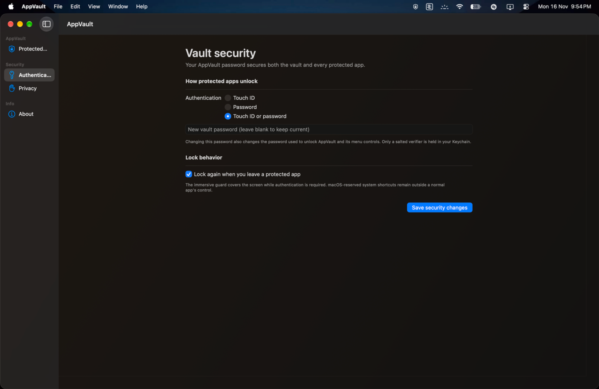
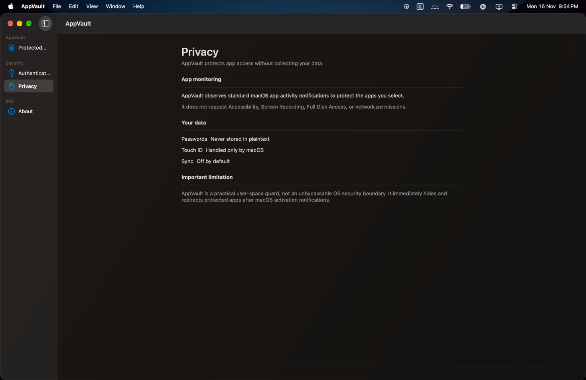
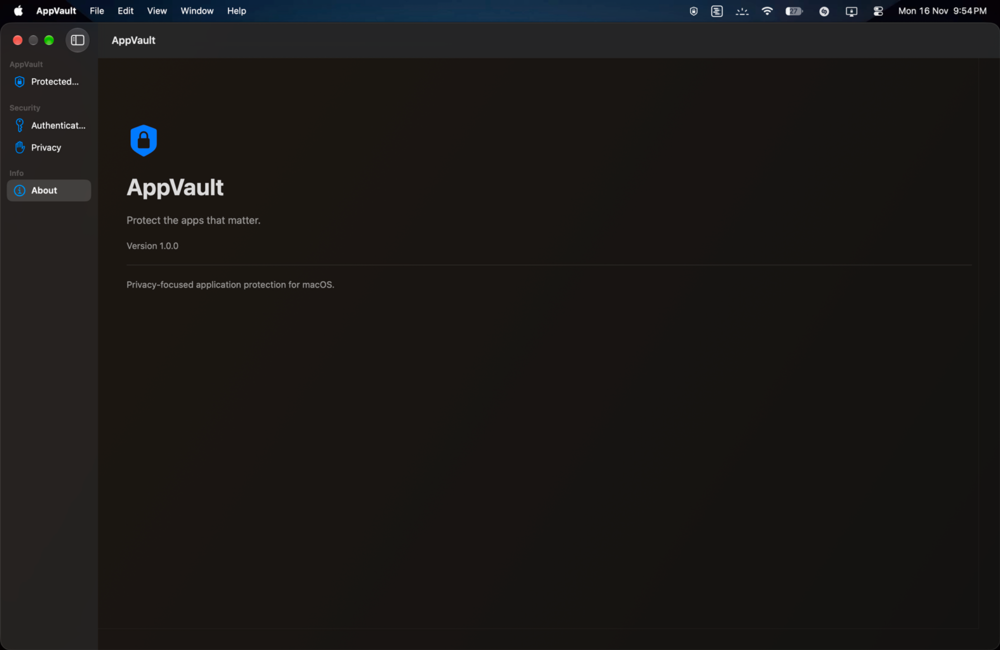

# 🔐 AppVault

**A privacy-focused macOS application protection utility.**

AppVault is an offline-first macOS menu-bar application that helps protect selected applications using Touch ID and/or a locally configured vault password.

## ✨ Features

- **Menu Bar Integration** – Quickly monitor and control AppVault.
- **Protected Applications** – Add, search, and manage applications.
- **Touch ID Authentication** – Use Apple's native biometric authentication.
- **Password Protection** – Secure applications with a local vault password.
- **Individual App Policies** – Configure authentication and grace-period preferences.
- **Lock Behaviour** – Configure protection when leaving protected applications.
- **Vault Controls** – Seal and unseal application settings.
- **Privacy First** – Local-first architecture with Keychain-based storage.

## 🛠️ Technology Stack

- Swift 6
- SwiftUI
- AppKit
- Apple LocalAuthentication
- Security / Keychain Services
- CryptoKit
- XCTest

**Platform:** macOS 14+

## 🏗️ Architecture

1. User selects applications for protection.
2. AppVault stores protection configuration locally.
3. AppVault observes standard macOS application-activity notifications.
4. When a protected application launches or is reactivated, the authentication flow is presented.
5. Authentication is handled through Touch ID or the configured vault password.

## 🔒 Security & Privacy

- Passwords are never stored in plaintext.
- Salted password verifiers are stored in the macOS Keychain.
- Touch ID is handled by macOS.
- Sensitive values are not logged.
- No server connection is required for local protection.

**Important:** AppVault is a practical user-space launch-monitoring deterrent, not an unbypassable operating-system security boundary. It is not a replacement for FileVault, MDM enforcement, or separate macOS user accounts.

Encrypted synchronization is not implemented or enabled.

## 🚀 Getting Started

Clone the repository:

```bash
git clone https://github.com/jahajeevan/AppVault.git
cd AppVault
```

Build:

```bash
swift build
```

Run tests:

```bash
swift test
```

Open the Xcode project:

```bash
open AppVault.xcodeproj
```

Requires macOS 14+ and Xcode with the Swift 6 toolchain.

## 📂 Project Structure

```text
AppVault/
├── AppVault.xcodeproj/
├── Assets/
├── Configuration/
├── Scripts/
├── Sources/
│   └── AppVault/
├── Supabase/
│   └── migrations/
├── Tests/
│   └── AppVaultTests/
└── Package.swift
```

## 📦 Distribution

The repository includes a DMG packaging helper. External distribution requires appropriate Developer ID signing, notarization, and validation on a clean Mac.

## 🧪 Validation

Physical-device testing of authentication, application monitoring, Keychain persistence, and cancellation behaviour should be completed for the intended macOS versions before release.

## 👨‍💻 Author

**Jahajeevan V**

Computer Science Undergraduate | Full-Stack Developer | AI & Automation Builder

GitHub: https://github.com/jahajeevan

LinkedIn: https://www.linkedin.com/in/jahajeevan-v-99774a379/


## 📸 Application Screenshots

### Menu Bar Integration


### Protected Applications


### Add Protected Application


### Authentication Settings


### Privacy Settings


### About AppVault



## 📄 License

No license has been added yet. All rights remain reserved unless a license is added.

---

*Built as a macOS privacy and application-security project.*
